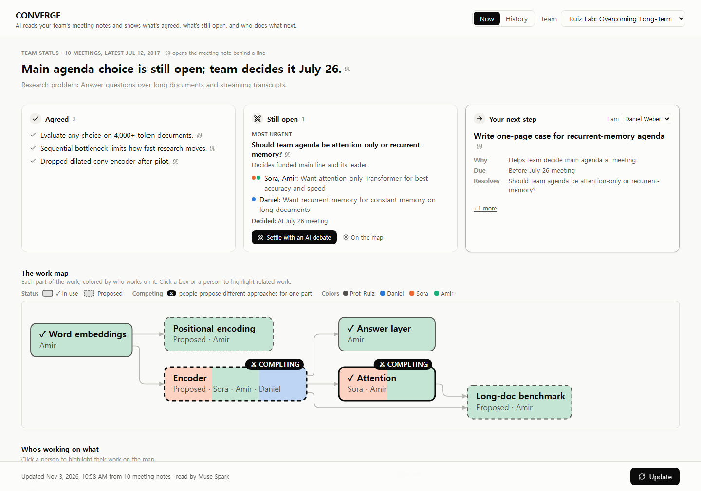
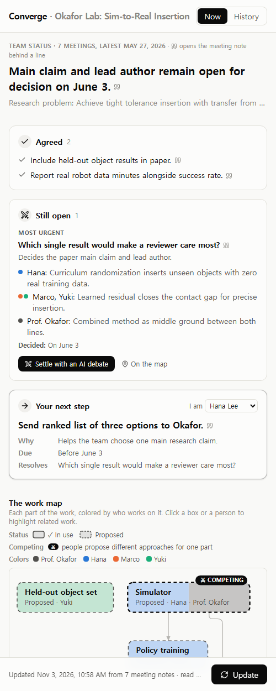
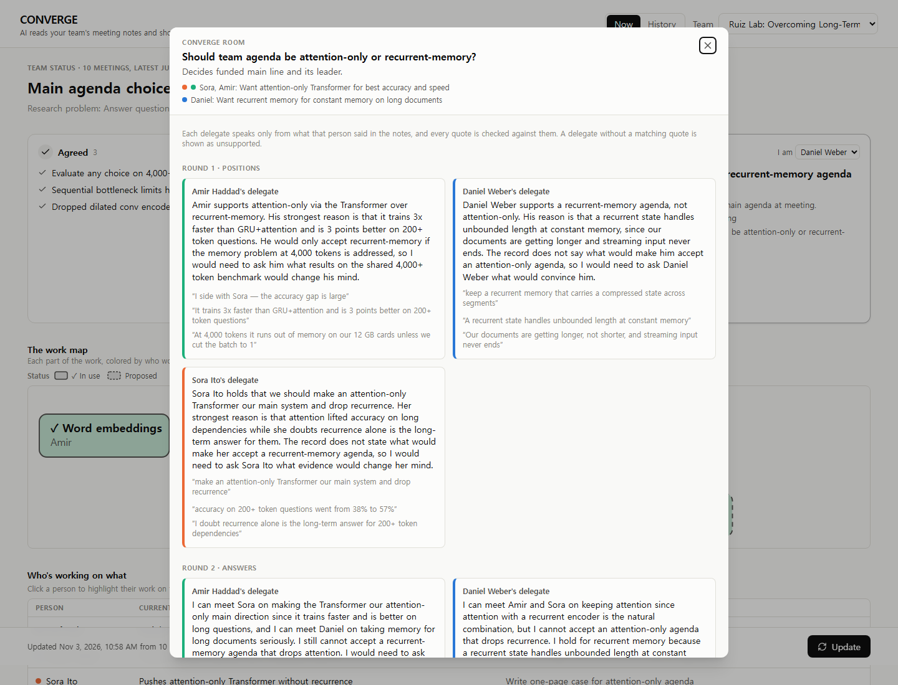
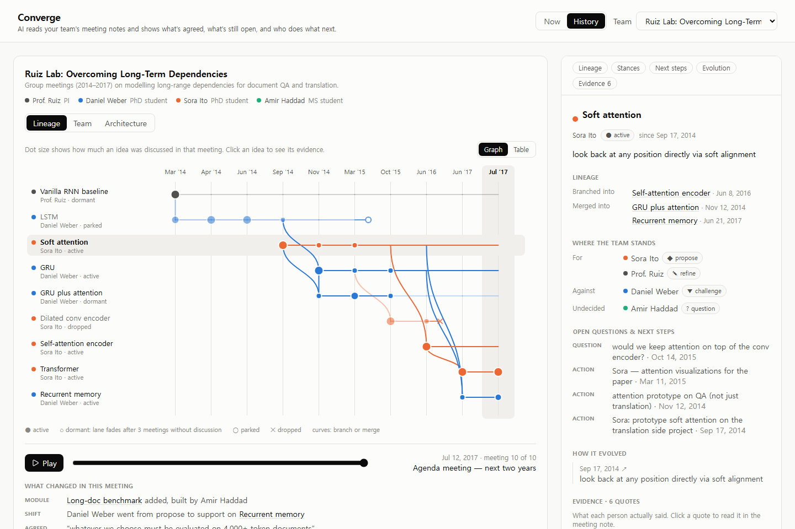
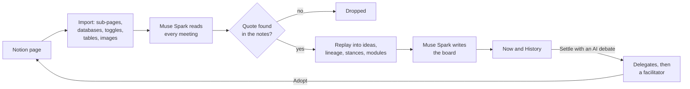

# Converge

**AI reads your team's meeting notes and shows what's agreed, what's still open, and who does
what next. Every claim links to the line of the notes it came from.**



Research teams make their decisions in meetings and keep the record in Notion. A few months
later, nobody can say what was decided, who backed which idea, or why something was dropped.
Converge connects to that Notion page and has Muse Spark read every meeting, including tables,
toggles, and whiteboard photos. It turns the record into one screen: where the team stands,
how its ideas grew, and what each person does next. When a question is stuck, AI delegates
that may only use what their person actually said debate it, and the decision goes back into
Notion.

Built solo for the Meta Global AI Developer Hackathon 2026 (Indie track) on Muse Spark through
the Meta Model API. **Demo video:** _link coming with the submission._

## What you get

### Now: where the team stands

The first screen answers three questions in plain sentences: what the team **agreed**, what is
**still open** (the most urgent question, what it decides, and each side's position), and
**your next step**, with why and by when. Below them, the **work map** draws the project as one
diagram. Each part is split into the colors of the people working on it, dashed boxes are
proposals, and **⚔ COMPETING** marks a part where people propose different approaches. Click
a box or a person to highlight related work, or a quote mark to open the meeting note at that
line.

### Beside Notion

<table>
<tr>
<td>

A Chrome side panel shows the board next to the notes and follows the Notion page you are on.
A page that is not connected yet offers **Connect and update**; after that, **Update** reads
only new or changed notes and refreshes the board.

The panel keeps the whole board: the status, what is agreed, the open question with each side
and its **Settle with an AI debate** button, your next step, and the work map.

</td>
<td width="300"></td>
</tr>
</table>

### Converge Room: settle it with an AI debate



Every open question has a **Settle with an AI debate** button. Each member involved gets a
delegate that speaks only from what that member said in the notes. Its quotes are checked, and
a delegate without a matching quote is marked unsupported. The delegates state positions and
answer each other over two rounds. A facilitator then proposes two ways to settle the question,
each ending in who does what next and how likely each member is to accept. **Adopt** writes the
decision and the next steps to a session note and to Notion, and the board updates.

### History: how the ideas grew



A lineage graph of every idea, meeting by meeting: branches and merges, ideas that went dormant,
parked, or dropped (and why), and how each person's stance changed. **Play** replays the team's
history; clicking an idea shows its evidence. The Team view shows who stood where over time, and
the Architecture view shows how the work map changed. Edits made there (proposing, changing, or
removing a module, backing or challenging one, asking a question) go back to Notion as
session-note lines too.

## How it works



1. **Import.** The page is read with everything inside it: sub-pages, database rows, toggles,
   tables, and images (downloaded before Notion's links expire).
2. **Read.** Muse Spark reads the meetings in one long-context call, images included, and
   returns each meeting's analysis through a strict JSON schema: ideas and how they branch and
   merge, each member's stance, decisions, action items, open questions, and changes to the
   modules of the work with who builds or proposes what. Later updates read only new or changed
   notes, with the ideas found so far as context.
3. **Check.** Every quote is matched against the notes: exactly, then with typography folded,
   then as a near-identical sentence, whose wording from the notes replaces the model's.
   Anything else is dropped. No quote, no claim.
4. **Replay.** The checked analyses are replayed in time order into ideas, lineage edges,
   stances, items, and modules, so the team can be shown as of any meeting.
5. **Brief.** A second call writes the board from the replayed state and the latest notes, and
   its claims go through the same check.

## How Converge uses Muse Spark

Every model call runs on Muse Spark (`muse-spark-1.3`) through the Meta Model API.

| Call | Reads | Returns | Reasoning effort |
|---|---|---|---|
| Read the notes | The meetings in one call (up to 30,000 characters per batch; each demo team fits in one), their images as image input, and the ideas found so far | Each meeting's ideas with branch and merge links, stances, decisions, actions, questions, and module changes, every item with a quote | low |
| Find the team | New or changed notes, with the roster so far | People not on the roster yet, with roles and aliases | low |
| Write the board | The replayed state and the three latest notes in full | Status headline, problem, agreed points, each person's idea and next steps, open questions with sides and stakes | medium |
| Delegate, one per member, two rounds in parallel | That member's own statements and the other delegates' turns | A position with quotes | low |
| Facilitator | The quote-checked turns | Two proposals: a decision, who does what next, likely acceptance, and the risk | medium |

- **Structured output.** Every call uses a strict `json_schema` response format generated from
  the Pydantic models in `backend/app/models.py`. If an answer still fails validation, the
  model sees its answer and the error and tries again.
- **One client.** All calls go through `backend/app/llm.py`, which adds retries, a SQLite cache
  keyed by the request, and a cost log.
- **Standard tier only.** Meeting notes are never sent to a `-contributor` model, which would
  train on them; the client refuses one.
- **Cost.** Reading costs about $0.01 per meeting, so a ten-meeting team costs about $0.11 to
  update. A Converge Room costs about $0.06.

## Evaluation

The three demo teams (28 meetings) are hand-labelled with the same structure the model produces:
ideas and how they branch and merge, each member's stance, decisions, actions, and questions,
every label tied to a verbatim quote. `cd backend && uv run python -m app.evaluate` compares
Muse Spark's analyses with those labels. The model names ideas in its own words, so its ideas are
first matched to the labelled ones through the statements (meeting, line, speaker) they share.

| Metric | long-term-dependency | self-organizing-agents | sim-to-real | Mean |
|---|---|---|---|---|
| Ideas found (gold → model) | 9 → 9 | 7 → 8 | 6 → 6 | – |
| Idea grouping, B³ F1 | 0.90 | 0.85 | 0.94 | 0.89 |
| Lineage edges (branch/merge), F1 | 0.75 | 0.91 | 1.00 | 0.89 |
| Parked/dropped ideas caught | 0.67 | 1.00 | 1.00 | 0.89 |
| Final idea status, accuracy | 0.62 | 1.00 | 1.00 | 0.88 |
| Gold stances the model also found | 0.78 | 0.71 | 0.82 | 0.77 |
| Stance, exact | 0.89 | 0.78 | 0.78 | 0.82 |
| Stance side (for / against / neutral) | 0.91 | 0.86 | 0.83 | 0.87 |
| Speaker attribution | 0.98 | 1.00 | 1.00 | 0.99 |
| Decisions, F1 | 0.62 | 0.77 | 0.44 | 0.61 |
| Action items, F1 | 0.94 | 0.98 | 0.82 | 0.91 |
| Open questions, F1 | 0.86 | 0.80 | 0.89 | 0.85 |
| Quotes copied verbatim | 1.00 | 0.99 | 1.00 | 1.00 |
| Claims kept after the quote check | 1.00 | 0.97 | 1.00 | 0.99 |
| Converge Room turns backed by a quote | 1.00 | 1.00 | 1.00 | 1.00 |
| Cost per meeting (USD) | $0.0106 | $0.0109 | $0.0159 | – |
| Model time per meeting (s) | 19.0 | 18.9 | 30.4 | – |

One prompt revision, guided by the errors of the first run, moved the main numbers (mean of the
three teams):

| Metric | First prompt | Revised prompt |
|---|---|---|
| Idea grouping, B³ F1 | 0.83 | 0.89 |
| Lineage edges, F1 | 0.77 | 0.89 |
| Stance, exact | 0.66 | 0.82 |
| Stance side | 0.81 | 0.87 |
| Decisions, F1 | 0.58 | 0.61 |
| Final idea status | 0.96 | 0.88 |

The first run reported results as support instead of plain information, treated successors
such as GRU as new ideas rather than branches of LSTM, and missed calls made by the PI as
decisions; the revised prompt defines each of those. Final status got worse in one team because
later discussion attached to "GRU" instead of "GRU + attention", which changes which of the two
counts as dormant. The set is small and the revision was tuned on it, so read the numbers as a
sanity check rather than a benchmark.

## Quick start

```bash
git clone https://github.com/jmoongyu24/Meta-Global-AI-Developer-Hackaton-MK.git converge
cd converge && ./start.sh
```

`start.sh` installs [uv](https://docs.astral.sh/uv/) if it is missing (Node.js 20 or newer must
already be installed), asks once for your [Meta Model API key](https://dev.meta.ai/api-keys)
and, optionally, a [Notion integration token](https://www.notion.so/my-integrations), and saves
them only to `.env` in this folder. It then builds the web app, loads three demo teams, and
serves Converge at http://localhost:8000.

The demo teams' History works right away from their hand-labelled analyses. Press **Update** to
have Muse Spark read a team and write its board: about $0.11 and a few minutes for ten meetings.

### Use it with your own Notion notes

1. Create an integration at https://www.notion.so/my-integrations and give its token to
   `start.sh` (or add `NOTION_TOKEN=...` to `.env`).
2. In Notion, open the page that holds your meeting notes (sub-pages or a database of notes)
   and add the integration under **••• → Connections**.
3. In Chrome, open `chrome://extensions`, turn on Developer mode, click **Load unpacked**, and
   pick the `extension/` folder.
4. On the Notion page, click the Converge icon and press **Connect and update**. Without the
   extension, use **Team → + Connect a Notion page…** in the web app.

Converge writes to Notion only when you adopt a proposal or make an edit in the Architecture
view. It adds lines to a "Converge session" page under the connected page and never changes
your notes.

## Development

| Task | Command |
|---|---|
| API server with reload | `cd backend && uv run uvicorn app.main:app --reload` (docs at http://localhost:8000/docs) |
| Web app with hot reload | `cd frontend && npm run dev` (http://localhost:5173, proxies `/api` to :8000) |
| Tests | `cd backend && uv run pytest` |
| Lint and format | `cd backend && uv run ruff format . && uv run ruff check --fix .` and `cd frontend && npm run check` |
| Load the demo teams | `cd backend && uv run python -m app.ingest demo` |
| Analyze a team from the terminal | `cd backend && uv run python -m app.ingest analyze <workspace-id> [--fresh]` |
| Score against the gold labels | `cd backend && uv run python -m app.evaluate [--rooms] [--json]` |
| Copy a demo team into Notion | `cd backend && uv run python -m app.ingest push-notion <page-id> [--scenario <name>]` |

```
backend/app/
  main.py        FastAPI routes and background updates
  ingest.py      Notion and Markdown import, write-back to Notion, CLI
  pipeline.py    reading the notes, quote checks, replay, the board (prompts at the top)
  converge.py    Converge Room: delegates and facilitator
  llm.py         Meta Model API client: schema, retries, cache, cost log
  evaluate.py    scores against the gold labels
  models.py      Pydantic models for every model output and API payload
  store.py       SQLite storage (data/converge.db, or CONVERGE_DB)
frontend/src/    React app: BoardView (Now), LineageView, TeamView, ArchitectureView, ConvergeView
extension/       Chrome side panel
data/demo/       three synthetic teams with their gold labels
```

## Data and privacy

- The demo teams in `data/demo/` are synthetic: every person, meeting, and result is invented.
- Keys live only in `.env`, which git ignores and `start.sh` creates readable by you alone.
- Meeting notes go only to Muse Spark's standard tier.

## License

MIT, see [LICENSE](LICENSE). Third-party packages keep their own licenses; for example, elkjs,
which lays out the work map, is EPL-2.0.
