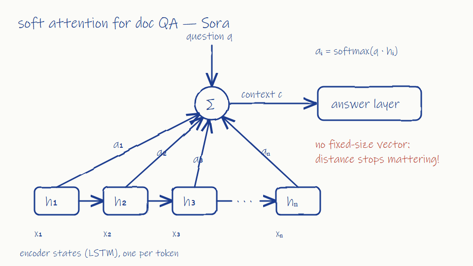

# Group meeting — attention?

Date: 2014-09-17 (Wed) 10:00–11:45
Attendees: Prof. Ruiz, Daniel, Sora, Amir
Note-taker: Amir

## LSTM updates
- Amir: Forget-gate bias 1.0 helps: +5 points on 100+ token questions. Peepholes: no measurable gain, dropping them.
- Daniel: Good — fewer moving parts. LSTM with forget bias is our standard cell from now on.

## New direction (Sora)
- Sora: Bahdanau, Cho and Bengio posted a paper on arXiv: the decoder learns a soft alignment over all encoder states instead of squeezing the input into one fixed vector.
- Sora: Proposal: add soft attention over all hidden states for our document QA. The model can look back at any position directly, so distance stops mattering.
  
- Daniel: Attention is a useful add-on, but you still need the recurrent encoder to produce those states. Recurrence stays the core.
- Prof. Ruiz: Interesting enough to try, but on the translation side project first, where the paper's setting matches.
- Amir: Question — attention over 1,000 positions per step: does that fit in GPU memory on our cards?
- Sora: For 1,000 positions it should; for full documents we will need to think about memory.

## Action items
- [ ] Sora: prototype soft attention on the translation side project
- [ ] Amir: measure attention memory use at 500 / 1,000 / 2,000 positions
