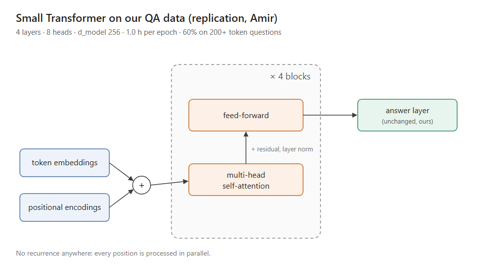

# Group meeting, June 21 2017 — Attention Is All You Need

Date: 2017-06-21, 10:00–12:10. Present: Prof. Ruiz, Sora, Amir, me (Daniel, notes).

Sora opened with the Vaswani et al. paper posted last week: an encoder-decoder built only from self-attention and feed-forward layers, with positional encodings and multi-head attention, no recurrence at all. Sora's proposal: make an attention-only Transformer our main system and drop recurrence.

Amir already replicated a small version on our QA data over the weekend. It trains 3x faster than GRU+attention and is 3 points better on 200+ token questions. Amir now thinks the attention-only model is the way forward and offered to help Sora scale it.

I pushed back. Self-attention is quadratic in length: our full documents are 4,000+ tokens and the streaming transcripts never end. A recurrent state handles unbounded length at constant memory. My counter-proposal: keep a recurrent memory that carries a compressed state across segments, and use attention within each segment.

Prof. Ruiz agrees the replication is strong evidence, but shares my memory concern for long documents. Asked both of us to bring numbers on 4,000-token documents.

Actions: Amir — Transformer on 1k / 2k / 4k token documents with memory profiling. Me — recurrent-memory prototype. Sora — draft the case for the lab's next two-year agenda.

📄 Transformer replication — Amir
  Setup: 4 layers, 8 heads, model width 256; trained on our QA data over the weekend.
  | Model | Hours per epoch | Accuracy, 200+ token questions |
  | --- | --- | --- |
  | GRU + attention (main system) | 3.0 | 57% |
  | Transformer, small | 1.0 | 60% |
  
