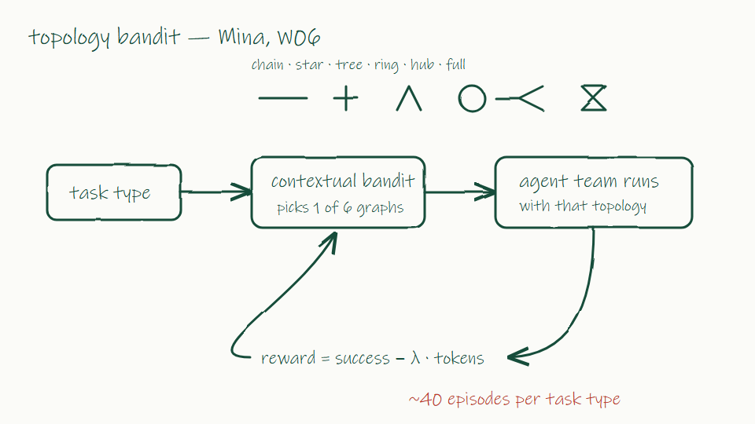

# Weekly 06 — pivot

2026-09-30, Wednesday 14:00–15:30 · all four of us · notes by Mina

I proposed the pivot I had been testing: instead of an RL policy, a contextual bandit picks one topology from a small library (chain, star, tree, ring, hub-and-spoke, fully connected) per task type, with reward = success minus token cost. It needs about 40 episodes per task type instead of thousands. The RL version is parked; I will not spend more GPU time on it this semester.

Prof. Han supported the pivot: much cheaper, still adaptive, and easy to explain.

Leo pushed back hard. In Leo's view a bandit over six fixed graphs is model selection, not self-organization — the agents themselves decide nothing. I disagree: the team's structure adapts to the task from experience, which is exactly the point. This became the main disagreement of the meeting: learning a structure from feedback (me) versus letting agents organize in-context without any training (Leo).

Jae asked whether the bandit's choices transfer across task types, or whether it has to start from scratch for every new type. Fair question; I don't know yet. On the suite, Jae saw the bandit settle on star for coding and tree for planning.

Action items
- Mina: bandit on all 5 suite tasks, report cost-adjusted success
- Leo: write down what self-organization means for our paper (one paragraph)
