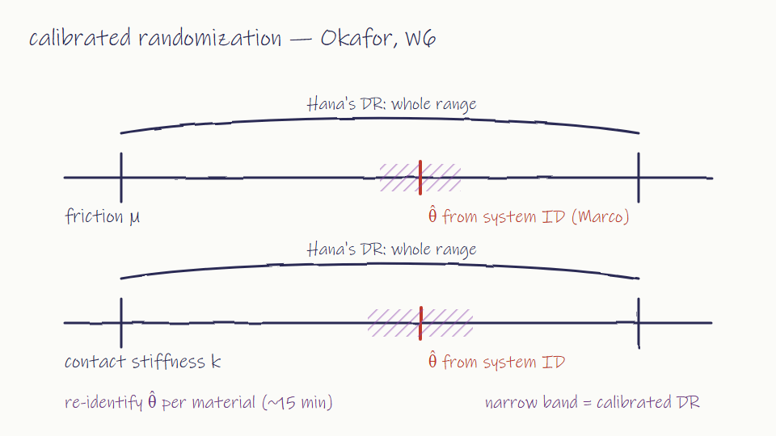

# W6 (Okafor notes) — 2026-05-13 Wed 13:00, all present

- Okafor: proposal — combine the two lines: identify parameters per material, then randomize in a narrow band around the identified values. Precision from calibration, robustness from randomization.
  
- Hana: partly on board; narrow bands keep the curriculum idea alive. Wants the band width learned, not fixed.
- Marco: skeptical — randomizing around a good estimate throws away precision we paid for with real data.
- Yuki: per-material re-identification done: residual model on brass 66% (was 52%). Supports Marco's numbers.
- Okafor: CoRL deadline in 5 weeks. One paper. The lead decides the main claim.
- Marco, Hana: both want to lead. Both say the other line can be an ablation.

Next
- Yuki: hardware runs of the combined method on brass + printed pegs
- Hana, Marco: one-page main-claim drafts by 05/27
