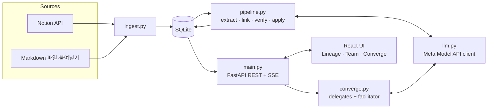

# Converge (가칭) — 개발 계획서

> Meta Global AI Developer Hackathon 2026 출품 계획 · **Indie track · 1인 개발** · 작성 2026-11-01
> **제출 마감: 11/4(수) 21:00 ET = 11/5(목) 11:00 KST** · 내부 목표: **11/5 09:00 KST 제출 완료**
> 개발 규칙은 [CLAUDE.md](../CLAUDE.md) 참고

---

## 0. 한눈에 보기

- **무엇을**: 연구실 회의록(Notion)을 읽어서 연구 아이디어를 "시간에 따라 진화하는 entity"로 추적하고, 누가 어떤 아이디어를 밀고 있는지 보여주고, multi-agent 토론으로 하나의 연구 방향으로 수렴하도록 돕는 서비스.
- **Pitch**: *"Git for your lab's research ideas."* 회의 = commit, 아이디어 갈래 = branch, 아이디어 결합 = merge, 누가 말했나 = blame.
- **남은 시간**: 약 3.5일. Must 기능(F0~F6)과 제출(F8)에 집중하고, 11/4 20:00 KST에 feature freeze.
- **진행 순서**: Meta API key(credit)가 오기 전에는 key 없이 되는 작업(F0a → F1 → F3 → F4 → F5)을 먼저 한다. F1의 gold label을 F2(LLM) 출력과 같은 schema로 만들어서, key 없이도 engine·API·UI를 실제와 같은 데이터로 개발한다. key가 오면 F2가 같은 schema를 만들도록 연결하고, gold와 비교한 결과가 곧 F7 eval이 된다.
- **모델 학습**: 없음. 모든 AI 기능은 Meta Model API 호출로 구현.
- **진행 현황 (11/1)**: F0a · F1 · F3 · F4 · F5 · F9 완료. Notion 실제 연동 확인 (시나리오 A 11개 page, 시나리오 B 10개 page를 표·이미지·토글·하위 page까지 올리고 다시 import해서 원본과 일치, 편집 write-back 확인). 남은 것은 key가 필요한 F0b · F2 · F6 · F7과 F8.

---

## 1. 대회 분석

### 1.1 핵심 요약

| 항목 | 내용 |
|---|---|
| 형식 | 10일 virtual hackathon (10/26~11/4 ET), 총상금 $1M |
| 사용 모델 | Meta Model API: Muse Spark, Muse Wonder, Muse Image, SAM 3.1 (+ Muse Voice Transcribe) / Open weights: Muse Spark Open, Muse Glimmer / Coding agent: Muse Code |
| Track (택1) | **Indie**: 개인·학생, 최대 4인 팀. 1~5등 $150k / $100k / $75k / $50k / $25k · **Startup**: 실제 제품을 만드는 팀. 1등 $250k |
| Theme | **Build for Your World** (직접 겪는 문제 해결) ← 우리 프로젝트 · Push the Frontier |
| 지원 | Meta Model API credit $150 (10일 유효), 파트너(Baseten·Modal·Fireworks) credit 각 $100 (선정자) |
| 일정 | 11/4 21:00 ET 제출 → 11/4~11/8 심사 → 11/9 live finals·수상 발표 |
| Bonus | community vote, most viral 등 최대 $50k 별도 |

### 1.2 평가 기준과 대응 전략

| 기준 | 비중 | 심사 포인트 | 우리 전략 |
|---|---|---|---|
| Impact | 30% | 누가 혜택을 받나, 얼마나 중요한가, 실제로 쓰일 수 있나, theme 적합성 | 본인 연구실의 실제 pain을 숫자로 제시 (회의 N회, 페이지 M개, 아이디어 K개). 팀원·교수님 사용 후기 한 줄. 연구실·R&D팀 전반으로 확장 가능성 |
| Use of Meta AI Tooling | 25% | 창의적 사용, basic integration을 넘어섰나, 예상 밖 capability를 보여줬나 | "요약 챗봇"이 아니라 ① structured output으로 idea knowledge graph + **아키텍처 graph** 구축 + quote 검증 ② **Spark의 image 입력으로 Notion 속 화이트보드·figure를 읽어 아키텍처에 반영** ③ member별 delegate agent의 multi-agent 토론 ④ Spark(대량 처리)·Wonder(최종 추론) model routing ⑤ 1M context로 연구실 전체 history 추론. Stretch: SAM 3.1 화이트보드 grounding, Muse Image, Voice Transcribe, open weights privacy mode |
| Technical Depth & Execution | 20% | engineering이 탄탄하고 다듬어졌나 | provenance 검증("No quote, no claim"), incremental pipeline, LLM cache·retry·비용 로깅, **gold label 기반 정량 eval** |
| Demo | 25% | 동작하는 인상적인 demo, live에서 버티나, 영상 품질 | time slider로 아이디어가 생기고 갈라지고 합쳐지는 animation → Converge Room에서 agent 토론 live streaming → 채택하면 lineage에 merge 노드 생성. 2~3분 영상 |

> Indie track 안내 문구의 "creativity, technical ambition, and whether it works"도 같은 방향이다. 특히 **"it works"**: live demo가 API 장애에도 죽지 않게 cache·fallback을 준비한다.

### 1.3 수상을 위해 꼭 챙길 것

1. **미발표 연구 아이디어 노출 금지**: 규정상 제출물과 공유 자료(Materials)는 confidential로 취급되지 않고, 주최측에 영구·취소불가 license가 부여된다. 본인·팀원·교수님의 실제 아이디어를 demo·repo·영상에 넣지 말고 **synthetic 연구실 데이터**로 demo한다. 실제 노트는 로컬 검증용으로만 (팀 동의 후).
2. **`-contributor` 모델 금지**: `muse-spark-1.3-contributor`는 훨씬 싸지만 입력이 Meta 제품 개선(학습)에 쓰인다. 실제 노트에는 standard model만 쓴다.
3. **Credit 관리**: $150, 10일 유효. LLM 응답 cache로 같은 호출에 두 번 과금되지 않게 한다.
4. **마감 여유**: 공식 표기는 11:00 KST, 일부 리스팅은 10:00 KST. 09:00 KST까지 제출한다.
5. **제출 양식 미리 확인 (11/2)**: [Cerebral Valley portal](https://cerebralvalley.ai/e/meta-ai-developer-hackathon/hackathon/submit)에서 영상 길이 제한, 필수 항목(repo 공개 여부, 팀원, 사용 모델 등)을 확인한다.
6. **Live URL 비용 방어**: 공개 URL은 누구나 API를 호출할 수 있다 → demo mode(미리 처리된 데이터 + converge rate limit).
7. **원작자성**: 오픈소스 사용 가능(license 준수), AI 도구 보조 OK. 결과물 권리는 본인 소유여야 한다.

---

## 2. 제품 정의

### 2.1 문제

- 연구 미팅이 쌓일수록 Notion 기록은 늘지만, "누가 어떤 아이디어를 밀고 있는지 / 아이디어가 어떻게 바뀌어 왔는지 / 다음 방향은 무엇인지"는 오히려 안 보인다.
- 결국 하나의 주제로 수렴해야 하는데, 기록이 많을수록 수렴이 어려워진다.

### 2.2 사용자

- **1차**: 대학원 연구실(학생 + 교수). 아이디어 탐색 단계에서 주간 미팅을 하는 팀
- **2차**: 기업 R&D팀, 스타트업 product discovery 팀, 논문 스터디 그룹. 즉 "여러 회의에 걸쳐 아이디어를 발산하고 수렴해야 하는 모든 팀"

### 2.3 핵심 개념

- 아이디어를 "문서"가 아니라 **시간에 따라 진화하는 entity**로 다룬다. 회의마다 아이디어가 생기고(new) 다듬어지고(update) 갈라지고(branch) 합쳐지고(merge) 보류·폐기(park/drop)되는 과정을 자동으로 기록한다.
- 회의록뿐 아니라 각자의 개인 아이디어 노트도 source로 받는다 (작성자 = 그 아이디어의 owner).
- 모든 정보(누가 무엇을 제안·지지·우려했나)는 회의록 원문 quote에 연결되고, 원문에 실제로 있는지 프로그램으로 검증한다. **"No quote, no claim."**

### 2.4 기존 서비스와의 차이

| | Notion AI | NotebookLM | 회의록 AI (Otter, Fireflies 등) | Miro·FigJam AI | **Converge** |
|---|---|---|---|---|---|
| 정리 단위 | 페이지·문서 | 업로드한 source | 회의 1건 | 보드(수동) | **아이디어 entity** |
| 회의 간 아이디어 변화 | 물어보면 답변 | 물어보면 답변 | ✗ | ✗ | **lineage 자동 구축 + time slider** |
| 사람별 입장 | 부분적 | ✗ | 화자 구분(회의 단위) | ✗ | **member × idea stance matrix** |
| 시각화 | ✗ | mind map(정적) | ✗ | 수동 | **시간축 lineage graph + team map + 아키텍처 diagram 자동 생성** |
| 아키텍처·담당 | ✗ | ✗ | ✗ | 수동으로 그림 | **회의록·표·이미지에서 자동으로 그리고, 회의별 diff, module별 담당자 색, 함께 편집 → Notion에 기록** |
| 수렴 지원 | ✗ | ✗ | action item | 수동 | **member별 delegate 토론 → 수렴안 + 역할 분담** |
| 근거 | citation | citation | transcript | ✗ | **원문 quote 프로그램 검증** |
| 도입 비용 | Notion 내장 | 업로드 필요 | 녹음 필요 | 새 보드 | **Notion 그대로 sync** |

**차별점 요약**: 기존 도구는 "문서·회의"를 정리하고, Converge는 "아이디어"를 추적하고 "수렴"시킨다.

1. **Idea Lineage**: 아이디어의 탄생·분기·병합을 git graph처럼 시간축에 시각화
2. **Who's on what**: 누가 어떤 아이디어를 담당·지지·우려하는지 한 화면에
3. **Architecture Canvas**: 회의에서 논의한 모델·시스템 구조를 자동으로 그리고(표·토글·이미지 포함), 회의마다 무엇이 추가·채택·제거됐는지 diff로 보여준다. module 색 = 만드는 사람. 팀원이 그 자리에서 담당·연결·질문을 편집하면 회의록 한 줄로 기록되고 Notion에도 써진다
4. **Converge Room**: 각 member의 발언만 근거로 말하는 delegate agent들이 토론해서 수렴안(통합 research question + member별 역할 분담 + 첫 실험)을 제안. "MAS 연구팀이 MAS로 수렴한다"는 story
5. **Verified provenance**: 모든 노드·module·주장이 검증된 원문 quote로 연결
6. **Zero friction**: 새 노트 습관 없이 기존 Notion 위에서 동작

---

## 3. 기능 정의 (MoSCoW)

| ID | 기능 | 우선순위 | 핵심 내용 | 사용 모델 |
|---|---|---|---|---|
| F0 | Foundation | Must | 개발 환경, LLM client(cache·retry·비용 로깅), API smoke test | muse-spark-1.3 |
| F1 | Ingest + Demo dataset | Must | Notion sync / Markdown import, synthetic 연구실 데이터 + gold label | — |
| F2 | Extract & Link | Must | 회의별 아이디어·발언자·stance·질문·결정·할 일 추출, 기존 아이디어와 연결, quote 검증 | muse-spark-1.3 |
| F3 | Lineage & Insights + API | Must | idea graph·version 이력, 시점별 snapshot, dormant 감지, stance matrix, 변화 digest, REST/SSE API | (규칙 기반) |
| F4 | Lineage View + Idea Canvas | Must | git-graph 스타일 timeline, time slider 재생, 아이디어 상세(canvas·이력·근거) | — |
| F5 | Team View | Must | member별 현재 아이디어, stance matrix, 지난 회의 이후 변화 | — |
| F6 | Converge Room | Must | delegate 토론 live streaming, 수렴안 비교·채택 → lineage에 merge 반영, 다음 회의 agenda | muse-spark-1.3, muse-wonder-1.0 |
| F7 | Eval | Should | gold 대비 정량 평가, README에 결과 표 | — |
| F8 | Ship | Must | 배포(demo mode), README, demo 영상, 제출 | — |
| F9 | Architecture Canvas | Must (11/1 추가) | 회의록(표·토글·이미지·하위 page 포함)에서 아키텍처 graph 추출, 시점별 diff, 담당자 색, 함께 편집 + Notion write-back | muse-spark-1.3 (vision) |
| S1 | 화이트보드·figure 이해 | Could | Notion 이미지 → Spark vision으로 내용 추출, SAM 3.1로 영역 grounding (노드 클릭 → 사진 영역 highlight) | muse-spark-1.3, sam-3.1 |
| S2 | Idea concept diagram | → F9 | F9 Architecture Canvas로 확장되어 구현 | muse-spark-1.3 |
| S3 | Graphical abstract | Could | 채택된 수렴안의 개념 이미지 | muse-image-1.0 |
| S4 | Notion write-back | 일부 → F9 | 편집 기록(session note) write-back은 F9에서 구현. 다음 회의 agenda page 생성은 F6에서 | — |
| S5 | 회의 녹음 입력 | Could | 녹음 파일 → transcript → ingest | muse-voice-transcribe-1.0 |
| S6 | Privacy mode | Could | base URL만 바꿔서 self-hosted open weights로 실행 | Muse Glimmer / Spark Open |

Stretch는 Must가 모두 끝난 뒤 S1 → S2 → S4 순서로 진행한다 (점수 기여 대비 비용 순).

---

## 4. 시스템 설계

### 4.1 Architecture



배포할 때는 FastAPI가 React build 결과도 함께 serve한다 → 서버 1개.

### 4.2 AI pipeline (source 단위, 시간순 처리)

1. **Normalize**: 회의록을 줄 번호가 붙은 markdown으로 변환. member 명단(별칭 포함, 예: "교수님", "Prof. Han")과 Notion block 작성자 정보를 hint로 붙인다.
2. **Extract & Link** (muse-spark-1.3, structured output): 입력은 이번 회의록(표·토글·하위 page를 펼친 Markdown + 이미지는 image 입력) + **지금까지의 idea registry와 아키텍처**(id·제목·요약·상태). 출력은 아래 네 가지.
   - `mentions`: 어떤 아이디어를 / 누가 / 어떤 stance(propose·support·refine·question·challenge·inform)로 / 원문 quote
   - `ops`: new · update · branch(parent 1개) · merge(parent 2개 이상) · park · drop + 근거 quote
   - `items`: question · decision · action · consensus(팀 전체가 동의한 점) + 담당자, 관련 아이디어·module
   - `modules`: 아키텍처 변경 add · update · remove (제목, 설명, 담당자, proposed·adopted, 입력 module, 속한 block, 구현하는 아이디어) + 근거 quote. 이미지에서 읽은 내용은 그 이미지 줄(caption)을 quote로 단다
   - 이 출력 schema가 `models.py`의 `SourceAnalysis`이고, gold label도 같은 schema다. 줄 번호는 LLM이 아니라 Verify 단계에서 계산한다.
3. **Verify**: quote가 해당 줄에 실제로 있는지 검사. 정확히 일치하지 않으면 rapidfuzz 유사도 ≥ 90일 때 원문 구간으로 보정하고, 그래도 실패하면 버리고 로그를 남긴다.
4. **Apply**: LLM이 아니라 코드가 ops를 적용해서 ideas · idea_versions · edges · items를 갱신한다. 모든 행에 source_id가 붙어 있어서 "그 시점의 상태"를 언제든 재구성할 수 있다 → time slider.
5. **Insights**: 최근 K회 언급이 없는 아이디어 → dormant, member별 profile, stance matrix, 미해결 질문 추적.

> **시간순 순차 처리 이유**: 이전 회의까지의 registry를 context로 넘겨야 같은 아이디어를 회의마다 일관되게 연결할 수 있다. 한 번 처리한 회의는 cache되므로 새 회의만 추가로 처리한다 (incremental).

### 4.3 Converge Room (multi-agent)

```
[사용자] 수렴 대상 아이디어·member 선택
   ↓
Round 1  각 Delegate가 입장 정리 (병렬, muse-spark-1.3)
         - 해당 member의 발언만 근거로, 모든 주장에 quote citation 필수
         - 근거가 없으면 "unknown — ask {member}"
Round 2  서로의 입장을 보고 호환점·충돌점 응답 (병렬)
Round 3  Facilitator가 수렴안 2~3개 작성 (muse-wonder-1.0, structured output)
         - 통합 research question / 합쳐지는 아이디어 / member별 역할 분담
         - 첫 2주 실험 / risk / 남은 쟁점 / 각 delegate의 예상 수용도
   ↓
[사용자] 수렴안 비교 → Adopt → 새 converged 아이디어 + merge edges → Lineage View에 반영
         + 다음 회의 agenda(markdown) 생성
```

- UI에 "delegate는 기록 기반 simulation"임을 명시하고, citation 유효 비율(faithfulness)을 함께 보여준다.
- muse-wonder-1.0(preview) 접근이 안 되면 muse-spark-1.3 + 높은 reasoning effort로 대체한다.

### 4.4 Data model (SQLite)

| Table | 주요 column | 설명 |
|---|---|---|
| workspaces | id, name, description, notion_page_id | 팀(연구실) 단위. 아래 모든 table이 workspace_id를 가진다. notion_page_id는 편집을 써 넣을 Notion page |
| members | id, name, role, aliases | 교수·학생. aliases는 회의록에서 부르는 이름 ("Prof", "D") |
| sources | id, kind(meeting·note), occurred_at, title, text, url | 회의록·개인 아이디어 노트 |
| analyses | source_id, origin(gold·llm·user), analysis(json) | 회의별 분석 결과(`SourceAnalysis`). 정답(gold)·LLM 출력을 나란히 보관하고, UI 편집(user)은 어느 쪽을 replay하든 함께 적용 |
| assets | workspace_id, name, media_type, data | 회의록 속 이미지 (Notion 파일 link는 1시간 뒤 만료되므로 import할 때 저장) |
| converge_sessions | id, idea_ids, transcript(json), proposals(json), adopted | 수렴 세션 기록 |
| llm_cache | key, response, model, tokens_in, tokens_out, cost, created_at | 응답 cache + 비용 로그 |

아이디어·version 이력·edge·stance·아키텍처 module은 저장하지 않고, analyses를 시간순으로 replay해서 매번 계산한다 (`pipeline.build_state`). git이 commit을 쌓아 tree를 만드는 방식과 같아서 time slider가 어느 시점이든 정확하고, gold와 LLM 출력을 같은 코드로 비교할 수 있다.

### 4.5 Model routing과 예상 비용

| Task | Model | 이유 |
|---|---|---|
| Extract & Link, Delegates | `muse-spark-1.3` | 반복 호출이 많음. $1.25 / $4.25 per 1M tokens, 1M context |
| 최종 수렴안 synthesis | `muse-wonder-1.0` | 가장 어려운 추론. 비싸지만 호출 수가 적음 |
| (S1) 이미지 이해·grounding | `muse-spark-1.3` vision + `sam-3.1` | |
| (S3) graphical abstract | `muse-image-1.0` | $0.01/image |
| (S5) 녹음 → text | `muse-voice-transcribe-1.0` | |

- 예상 비용(추정): demo dataset 10회 처리 ≈ $0.2, converge session 1회 ≈ $0.3~0.5 → credit $150 대비 여유. 개발 중 반복 호출은 cache로 막는다.
- API: base URL `https://api.meta.ai/v1` (OpenAI-compatible), 인증은 `MODEL_API_KEY` (Bearer). structured output 문법은 F0 smoke test에서 확정한다.

---

## 5. 기술 스택과 개발 도구

| 영역 | 선택 | 이유 |
|---|---|---|
| Backend | Python 3.12 (uv), FastAPI, Pydantic v2, openai SDK, notion-client, rapidfuzz | AI 로직은 Python이 익숙하고 이해·수정이 쉽다. Meta Model API가 OpenAI-compatible이라 openai SDK를 그대로 쓴다 |
| DB | SQLite (Python 내장 sqlite3) | 설치·운영 부담이 없고, 파일 1개로 demo 데이터를 배포할 수 있다 |
| Frontend | Node.js LTS, Vite + React 19 + TypeScript, Tailwind CSS v4, @xyflow/react (React Flow), lucide-react | graph 시각화는 React Flow가 가장 빠르게 고품질 결과를 낸다 |
| 품질 | Ruff (Python lint·format), Biome (TS lint·format), pytest | 도구 수와 설정 파일 최소화 |
| 협업 | Git + GitHub, gh CLI, GitHub Issues (F0~F8) | |
| AI 개발 도구 | Claude Code, (선택) Muse Code | |
| 확인 도구 | FastAPI Swagger UI (`/docs`), VS Code SQLite Viewer | API·DB를 눈으로 확인 |
| 배포 | Modal (파트너 credit, cold start 빠름) / 대안 Render | |
| 영상 | OBS Studio (녹화) + CapCut 또는 DaVinci Resolve (편집) | |

**환경 이슈 (F0a에서 해결)**

- WSL에 Node가 없다. 지금 잡히는 npm은 Windows 쪽(`/mnt/c/Program Files/nodejs`)이라 WSL에서 쓰면 경로·속도 문제가 생긴다 → nvm으로 WSL에 Node LTS 설치.
- gh CLI 2.4.0(2022)은 오래된 버전이다. 기본 기능은 되지만 업그레이드를 권장한다.

---

## 6. Repository 구조 (계획)

코드 파일 수를 최소화하고, 역할이 같은 코드는 한 파일에 모은다. prompt는 별도 파일 없이 그 prompt를 쓰는 module 안에 둔다.

```
.
├── CLAUDE.md                  # 개발 규칙 (Claude·팀원 공통)
├── README.md                  # 제출용 소개 (English, F8)
├── docs/PLAN.md               # 이 문서
├── data/demo/                 # synthetic 회의록(.md) + gold.json
├── backend/
│   ├── pyproject.toml
│   ├── app/
│   │   ├── main.py            # FastAPI routes (REST + SSE), frontend serve
│   │   ├── models.py          # Pydantic schema (DB row, API, LLM 입출력)
│   │   ├── store.py           # SQLite 읽기·쓰기
│   │   ├── llm.py             # Meta Model API client: structured output, streaming, cache, retry, 비용
│   │   ├── ingest.py          # Notion API / Markdown → sources
│   │   ├── pipeline.py        # extract · link · verify · apply · insights (+ 해당 prompt)
│   │   ├── converge.py        # delegates + facilitator (+ 해당 prompt)
│   │   └── evaluate.py        # gold 대비 평가
│   └── tests/test_pipeline.py
└── frontend/
    └── src/
        ├── main.tsx, index.css
        ├── App.tsx            # layout, tab, 전역 상태 (선택한 시점·아이디어)
        ├── api.ts             # type 정의 + REST/SSE 호출
        ├── LineageView.tsx    # lineage graph + time slider + 상세 panel
        ├── TeamView.tsx       # member board + stance matrix
        ├── ArchitectureView.tsx # 아키텍처 diagram + module panel·편집 form
        ├── ConvergeView.tsx   # Converge Room
        └── ui.tsx             # 공용 작은 component (Badge, QuoteChip, IdeaCanvas …)
```

---

## 7. 기능별 개발 계획

각 기능은 `feat/f#-...` branch에서 작업 → 완료 기준(DoD) 확인 → 추천 commit message 제시 → 사용자가 확인 후 직접 commit 순서로 진행한다.

### F0a. Foundation (key 불필요) · 11/1(일) 저녁 · 1h

- WSL에 Node LTS 설치(nvm), `backend/`(uv + FastAPI)·`frontend/`(Vite + React + Tailwind) 초기화, `.gitignore`·`.env.example`
- **DoD**: `/api/health` 응답, `npm run dev` 화면에서 API 연결 상태 `ok`, `npm run build` 결과를 FastAPI가 serve

### F0b. LLM client + smoke test (key 도착 후) · 1h

- `llm.py`: openai SDK로 Meta Model API 호출, Pydantic schema 기반 structured output, SQLite cache, retry, token·비용 로깅
- smoke test로 확인할 것: ① structured output 문법 (Responses vs Chat Completions) ② streaming ③ muse-wonder-1.0 접근 가능 여부
- **DoD**: smoke test 3항목 결과 확인

### F1. Ingest + Demo dataset · 11/2(월) 오전 · 3h

- Notion: 지정한 parent page 아래 child page들 → block을 markdown으로 변환. 날짜는 제목·date property, 없으면 created_time. block 작성자(created_by)는 member 매핑 hint로 사용
- Markdown import: 파일 업로드 / 붙여넣기 (Notion export, Obsidian, Google Docs export도 수용)
- Demo dataset (synthetic): 하나의 큰 연구 주제 아래 3~5명이 여러 방향의 아이디어로 경합하는 회의 기록. 기록마다 시점(날짜·시간)과 member별 의견이 담기고, 공통 의견(align)과 대립 의견이 모두 존재한다. branch·merge·park·drop을 의도적으로 심어두고, 마지막 회의는 결론 없이 끝나서 Converge Room이 수렴을 이어받는다
  - 시나리오 3개 (모두 PhD 2명이 주도권 경합, MS 1명이 한쪽을 지원): self-organizing agents (11회, 2026), long-term dependency RNN → LSTM → GRU → Transformer (10회, 2014~2017), sim-to-real (7회, 2026). 상세는 [data/demo/README.md](../data/demo/README.md)
- 정답(gold.json)은 F2 출력과 **같은 schema**로 만든다 → key 없이 F3~F5를 개발하고, key가 오면 그대로 F7 eval에 쓴다
- (선택) demo 회의록을 Notion 테스트 workspace에 올리는 script. 영상의 "Notion 연결" 장면용
- **DoD**: demo 3개 시나리오 import 완료 (11/1). Notion은 Markdown ↔ block 변환을 28개 회의록 round trip test로 검증했고, 실제 연동도 test page 'Meta AI Hackaton Test' 아래 시나리오 A 11개 page로 확인 완료 (회의 시각·모든 줄 일치)
- 추가 (11/1, F9와 함께): 토글 `▸`, 표(`| a | b |`), 이미지(``), 하위 page(`📄 제목` + 내용), column·synced block, equation, link block까지 변환. 이미지는 import할 때 내려받아 DB(assets)에 저장하고, push할 때는 Notion File Upload API로 올린다. 한 요청에 2단계까지만 중첩할 수 있는 API 제약은 깊은 block을 나눠 보내서 해결. 시나리오 B 10개 page(토글 속 표, bullet 속 이미지, 표·이미지가 든 하위 page)를 올리고 다시 import해서 모든 줄과 이미지 byte까지 일치 확인

### F2. Extract & Link · 11/2(월) 오후 · 4h

- `pipeline.py`: 회의별 prompt 구성 (줄 번호, 명단, registry, 현재 아키텍처) → structured output → quote 검증 → ops 적용. 회의록 속 이미지는 Spark에 image 입력으로 함께 보내고, 아키텍처 변경(`modules`)도 같은 호출에서 추출한다
- session note(UI 편집 기록)는 이미 정확한 analysis가 있으므로 LLM 처리에서 제외
- 실패 대비: schema 검증에 실패하면 오류 메시지를 붙여 재요청 (최대 2회), 존재하지 않는 idea id 참조 차단
- key가 늦게 오면: prompt·schema·검증 코드를 먼저 작성해 두고, key가 오면 실행·튜닝만 한다
- **DoD**: demo dataset 전체 처리 → ideas·mentions·edges 생성, quote 검증 통과율 ≥ 95%, 재실행 시 전부 cache hit (비용 0)

### F3. Lineage & Insights + API · 완료 (11/1)

- `pipeline.build_state`: analyses를 시간순으로 replay해서 아이디어(상태·version 이력), branch·merge edge, stance matrix(member × idea 최신 입장), 해당 회의의 digest(적용된 ops·입장 변화·items), issues(검증에 실패해 버린 항목)를 만든다
- dormant: active인데 3회 연속 언급이 없는 아이디어를 자동 표시
- API: `GET /api/workspaces`, `GET /api/workspaces/{id}/state?as_of=&origin=gold|llm`, `GET /api/workspaces/{id}/sources/{source_id}` (원문)
- member profile·의견이 갈리는 구간은 UI가 stance matrix에서 바로 계산한다. `/api/ingest`·`/api/process`(SSE)는 LLM 처리와 함께 F2로 옮긴다
- **DoD**: Swagger 확인, pytest 17개 통과 (lineage·time travel·dormancy·입장 변화·잘못된 claim 차단·Notion round trip·API)

### F4. Lineage View + Idea Canvas · 완료 (11/1)

- git-graph 스타일 SVG: x축 = 회의, lane = 아이디어, 색 = owner, branch·merge 곡선, 점 크기 = 그 회의에서 언급된 양. 상태는 모양으로도 구분 (dormant는 흐려진 lane, parked ○, dropped ✕)
- 색: 교수는 중립 회색, 학생 3명은 validator로 검증한 categorical 색 (blue·orange·aqua, 모든 pair 통과). 색만으로 구분하지 않도록 이름 label·glyph를 항상 함께 표시
- time slider + Play: 모든 시점의 상태를 미리 받아두고 회의 단위로 이동, 새로 생긴 선·점은 fade-in
- 아이디어 panel: 요약, 계보(From / Led to), 팀원별 입장(For·Against·Undecided), 질문·할 일, 변화 이력, 근거 quote. quote를 누르면 원문 회의록에서 해당 줄을 highlight (Notion source면 Notion 링크)
- 회의 digest: 그 회의에서 생긴 아이디어 변화·입장 변화·합의·결정
- Table view, keyboard 선택, deep link (`?ws=&at=&idea=`로 같은 화면 재현 → demo 영상·공유용)
- 문제·접근·기대 기여 같은 구조화 필드는 LLM 추출(F2) 이후 검토
- **DoD**: 3개 시나리오를 headless Chrome으로 캡처해서 lineage·panel·시점 이동 확인

### F5. Team View · 완료 (11/1)

- 상단 요약: active 아이디어, 의견이 갈린 아이디어, 팀 합의, 미해결 질문 수
- 팀원 카드: Leads(담당) / Backs(지지) / Challenges(반대) / Next(할 일). 지지·반대는 최근 순으로 시점과 함께 보여서 편을 옮긴 것이 드러난다 (예: Amir가 '15 GRU+attention → '17 Transformer)
- 입장 matrix (member × idea): 지지는 채움, 반대는 테두리, 미정은 흐림. 팀원 색과 겹치지 않게 hue 대신 모양으로 구분. 의견이 갈린 아이디어가 맨 위, 닫힌 아이디어는 맨 아래. 칸을 누르면 그 입장의 원문 quote
- 합의·결정·미해결 질문 목록 (누르면 원문)
- Lineage | Team 탭: slider·digest를 함께 쓰고, deep link `view=team` 지원
- **DoD**: 3개 시나리오 캡처로 확인. 시나리오 A에서 Mina ↔ Leo 대립, Jae의 Leo 지지, 교수의 hybrid 추진이 한 화면에 보임

### F9. Architecture Canvas · 완료 (11/1)

- 배경: 연구 미팅에서는 모델·시스템 구조를 논의하는 일이 많다. 회의록의 글·표·토글·이미지를 바탕으로 구조를 그려주고, 팀원이 각자 맡은 부분을 색으로 보며 함께 다듬을 수 있어야 한다 (사용자 제안)
- schema: `SourceAnalysis.modules` = `ModuleOp`(add · update · remove, 제목, 설명, 담당자, proposed·adopted, 입력 module, 속한 block, 구현하는 아이디어, quote). LLM 출력과 gold가 같은 shape이고, 모든 변경에 quote가 붙는다
- replay: idea와 같은 방식으로 module 상태를 시점별로 재구성. 잘못된 참조(없는 module·담당자·아이디어, 자기 자신을 포함하는 block)는 버리거나 고치고 issue로 남긴다. block을 지우면 안의 layer도 함께 지워진다. module마다 변경 이력(누가 언제 무엇을 바꿨나 + quote)이 남는다
- 화면 (`ArchitectureView.tsx`): ELK layered layout으로 자동 배치 (block 안 layer 중첩, 직각 화살표). 색 = 만드는 사람(팀원 색), 실선 = 채택, 점선 = 제안. 이전 회의 대비 NEW · ADOPTED · NEW OWNER · CHANGED 배지, 제거된 module은 그 회의에서 흐린 흔적으로 표시. "Who builds what" 목록, time slider·Play로 구조가 바뀌는 과정 재생. ELK는 필요할 때만 불러와서 첫 화면 bundle은 그대로
- module panel: 담당자·상태·연결(Fed by · Feeds · Inside · Contains), 구현하는 아이디어와 팀원 입장, 질문·할 일, 변경 이력(quote 클릭 → 원문)
- 함께 편집: 최신 시점에서 담당 지정·채택·제거, 질문·할 일·지지·반대, 새 module 제안. 편집은 그날의 session note에 한 줄(작성자 이름 + 내용)로 기록되는 source가 되어 timeline·digest·Team view에 그대로 반영되고, "No quote, no claim"도 유지된다. 다른 브라우저는 5초 polling으로 변경을 받는다. workspace가 Notion page와 연결돼 있으면(`ingest notion`, `ingest link-notion`) 같은 줄을 Notion의 "Converge session" page에 써 넣는다
- 원문 viewer: 표·이미지·토글·하위 page를 Notion처럼 그린다. deep link `?quote=<source>:<line>`로 근거 줄을 바로 연다
- demo 데이터: 3개 시나리오에 module 변경 82개(gold), 표·토글 5곳, 화이트보드·figure 이미지 4장, 하위 page 1개 추가. 시나리오 B는 RNN encoder → LSTM → GRU + soft attention → Transformer block(multi-head self-attention·feed-forward)과 recurrent memory의 경합까지 그려진다
- **DoD**: pytest 23개 통과 (module replay·time travel·block 삭제·잘못된 module 차단·rich block 변환·이미지 API·편집 API), 3개 시나리오와 편집 session을 headless Chrome으로 캡처해서 확인, Notion 왕복(시나리오 B)·write-back 실제 확인

### F6. Converge Room · 11/4(수) 오전~오후 · 6h

- `converge.py`: Round 1~3 orchestration, SSE streaming, 수렴안 schema, Adopt → merge 반영, agenda 생성
- `ConvergeView.tsx`: 아이디어 선택 → 토론 live stream (agent별 말풍선 + citation chip, 클릭하면 원문) → 수렴안 카드 비교 → Adopt
- 수렴안에 "아키텍처 변경 + module별 담당자"를 포함해서, Adopt하면 F9 diagram에 바로 반영되게 한다 (F9의 편집 경로 재사용)
- **DoD**: demo dataset에서 3명의 아이디어를 수렴하는 session이 2분 안에 끝나고, delegate 주장의 citation이 전부 유효

### F7. Eval · 11/4(수) · 2h

- `evaluate.py`: idea clustering (B³ F1), 발언자 attribution 정확도, lineage edge F1, quote 검증률, delegate citation faithfulness, 회의당 비용·latency
- **DoD**: README에 결과 표

### F8. Ship · 11/4(수) 저녁 ~ 11/5(목) 09:00 · 5h

- 배포: demo mode (미리 처리된 demo DB, converge는 cache + rate limit)
- README (English): 문제, 해결, demo GIF, architecture, Meta 모델 사용 방식, eval 결과, 실행 방법
- Demo 영상 2~3분 → 제출 (필요하면 repo public 전환)
- **DoD**: 11/5 09:00 KST 전에 제출 완료

---

## 8. 일정

| Day | 날짜 (KST) | 작업 | Milestone |
|---|---|---|---|
| D0 | 11/1(일) 저녁 | 계획 확정, F0a | backend·frontend 연결 확인 |
| D1 | 11/2(월) | F1 (dataset + gold + ingest) · F3 (engine + API, gold로 구동), **제출 양식 확인** | API로 demo lineage 조회 → `v0.1.0` |
| D2 | 11/3(화) | F4 · F5, key가 오면 F0b → F2 | UI 완성 → `v0.2.0` |
| D3 | 11/4(수) | F2 마무리 · F6 · F7 · 배포, **20:00 feature freeze** | `v1.0.0` |
| D4 | 11/4(수) 밤 ~ 11/5(목) 09:00 | 영상 · README · 제출 | 제출 완료 |

key가 11/3 이후에 오면 F2·F6를 11/4에 몰아서 해야 한다. 그래서 F2·F6 코드는 key가 오기 전에 미리 작성해 둔다.

일정이 밀리면 자르는 순서: S\* 전부 → F7 축소 (핵심 지표 2개) → F5를 Lineage View 안의 panel로 축소. **F6 (Converge Room)은 끝까지 유지한다.** demo의 클라이맥스다.

---

## 9. Demo 시나리오 (영상 약 2분 30초)

| 시간 | 장면 |
|---|---|
| 0:00–0:20 | Problem: 실제 연구실 Notion이 끝없이 스크롤됨 (내용은 blur). "N주, M개 회의록. 지금 누가 뭘 하고 있지?" (실제 숫자로 교체) |
| 0:20–0:40 | Notion 연결 → pipeline 진행 상황 streaming |
| 0:40–1:10 | Lineage View: time slider 재생. 아이디어 탄생·분기·병합. 노드 클릭 → 검증된 원문 quote |
| 1:10–1:30 | Architecture: 같은 slider로 RNN encoder가 LSTM·GRU·attention을 거쳐 Transformer block으로 바뀌는 과정 재생. Notion 화이트보드 이미지가 module이 되는 장면, 팀원이 담당을 바꾸면 Notion에 한 줄이 생기는 장면 |
| 1:30–1:40 | Team View: stance matrix로 합의·충돌 지점 확인 |
| 1:40–2:15 | Converge Room: delegate 토론 live → 수렴안 → Adopt → lineage에 merge 노드 등장 |
| 2:15–2:40 | Under the hood (Meta 모델 사용 방식 + eval 수치) → Impact 한 문장으로 마무리 |

---

## 10. 리스크와 대응

| 리스크 | 대응 |
|---|---|
| 시간 부족 | MoSCoW 엄수, 11/4 20:00 feature freeze, 위의 "자르는 순서" |
| Meta API key·credit 도착 지연 | key 없이 되는 작업 먼저 (gold로 engine·UI 개발), F2·F6 코드는 미리 작성 |
| Meta API 동작 미확인 (structured output 문법, rate limit, Wonder preview 접근) | F0b smoke test로 먼저 확인. 안 되면 JSON prompt + Pydantic 검증 + 재요청, Wonder → Spark로 대체 |
| Model API 지역 제한 (Muse Spark public preview는 US 우선 공개) | hackathon credit으로 한국에서 호출되는지 F0b에서 확인. 안 되면 파트너(Baseten·Fireworks·Modal)의 Muse Spark Open으로 base URL만 교체 |
| 아이디어 연결 오류 | registry context, quote 검증, eval 결과로 prompt 개선 |
| 연구 아이디어 유출 | synthetic demo 데이터, standard model만 사용, 실제 노트는 로컬에서만 |
| Credit 소진 | cache, 호출별 비용 로그, 대량 작업은 Spark |
| Live demo 장애·비용 | demo mode (사전 처리 + cache), 영상은 사전 녹화 |
| WSL Node 미설치 | F0a에서 nvm으로 설치 (auto mode에서 외부 install script 실행이 막혀 사용자가 직접 실행) |

---

## 11. 결정 사항 (11/1)

1. Track: **Indie**, 1인 개발
2. Meta Model API key: credit($150)이 충전되면 전달받음 → 그 전에는 key 없이 되는 작업부터
3. Demo 데이터: **synthetic**. 하나의 큰 연구 주제, 3~5명, 경합하는 아이디어, 시점과 공통·대립 의견이 담긴 회의 기록
4. Commit: 작업이 끝나면 추천 commit message를 제시하고, 사용자가 확인 후 직접 commit
5. 제품명: 미정 (Converge 가칭으로 진행)
6. F9 Architecture Canvas 추가 (사용자 제안): 회의록의 표·토글·이미지까지 읽어 구조를 그리고, 담당자 색과 함께 편집·Notion write-back을 지원. key 없이 gold로 먼저 구현하고, F2에서 Spark vision으로 연결
